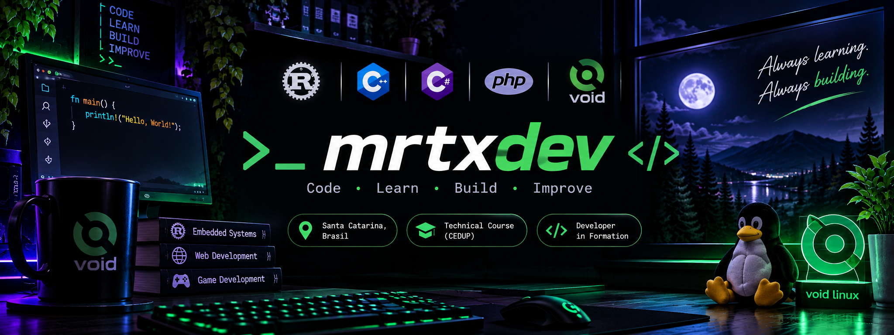

 

  

  
  
  

<h2 align="center">👨‍💻 About Me</h2>

  Developer in formation, passionate about programming, software engineering and technology.

Hello! I'm **Mateus**, a 17-year-old developer from Santa Catarina, Brazil.

I'm currently studying Computer Science at CEDUP (Technical Course in Informatics), constantly improving my programming skills and exploring different areas of software development.

- 💼 **Career Goal:** Looking for my first professional opportunity as a Web Developer.
- 🌐 **Web Development:** Knowledge of PHP and Web technologies.
- 🦀 **Current Focus:** Fully dedicated to learning Rust.
- 🎓 **Education:** Technical Course in Informatics — CEDUP.
- 🐧 **Operating System:** Void Linux.
- ⚙️ **Interests:** Embedded Systems, Game Development and Systems Programming.

<h2 align="center">🛠️ Technologies & Tools</h2>

<h3>🌐 Web Development</h3>

  

<h3>🦀 Current Focus</h3>

  

<h3>🚀 Future Learning Goals</h3>

  

<h3>💻 Environment & Tools</h3>

  

<h2 align="center">🎯 Areas of Interest</h2>

<table>
  <tr>
    <td width="33%" align="center">
      <h3>⚙️ Embedded Systems</h3>
      Exploring low-level programming, hardware interaction and microcontrollers.
    </td>
    <td width="33%" align="center">
      <h3>🌐 Web Development</h3>
      Building web applications, backend systems and practical solutions.
    </td>
    <td width="33%" align="center">
      <h3>🎮 Game Development</h3>
      Interested in game engines, gameplay programming and interactive experiences.
    </td>
  </tr>
</table>

<h2 align="center">📂 Projects</h2>

  Currently working on personal projects and expanding my development portfolio.

My repositories are under construction. New projects will be published soon, including:

- 🌐 Web applications and backend projects using PHP.
- 🦀 Rust projects focused on programming fundamentals and systems development.
- ⚙️ Experiments related to embedded systems and software engineering.

  <i>New repositories coming soon...</i>

<h2 align="center">📊 GitHub Statistics</h2>

  
  

  

---

<h2 align="center">💭 Philosophy</h2>

  <i>"Always learning. Always building."</i>

  <code>Code</code> &nbsp;•&nbsp; <code>Learn</code> &nbsp;•&nbsp; <code>Build</code> &nbsp;•&nbsp; <code>Improve</code>

  

